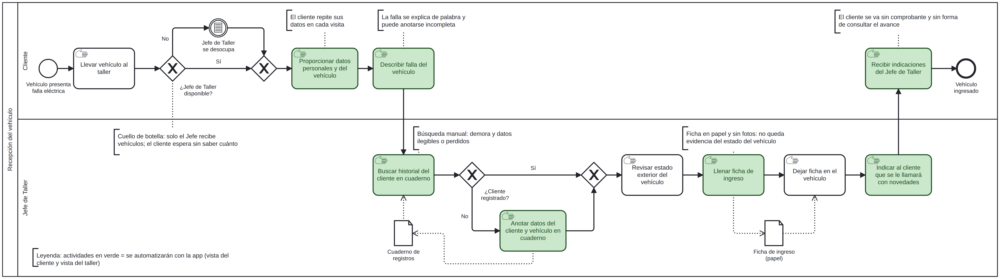
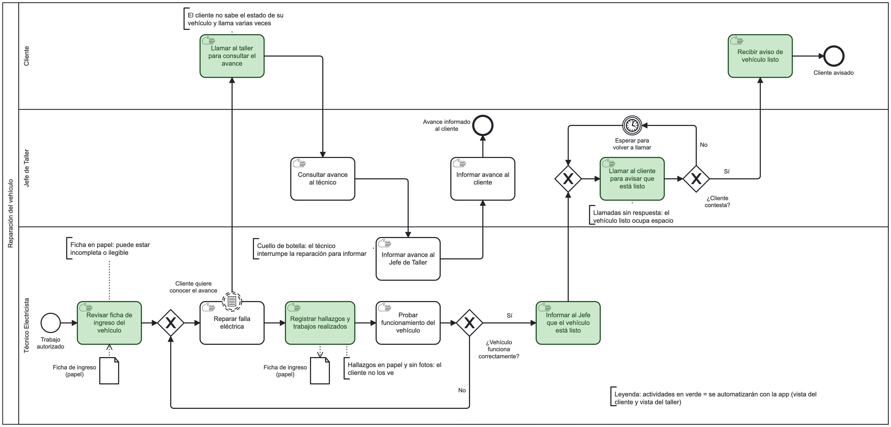
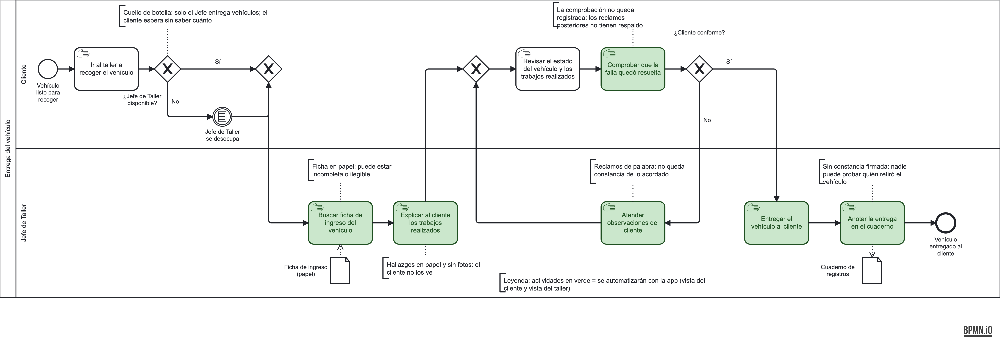
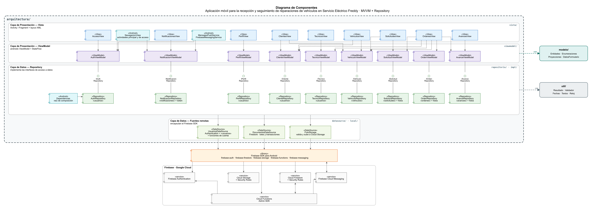
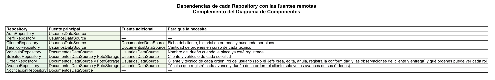
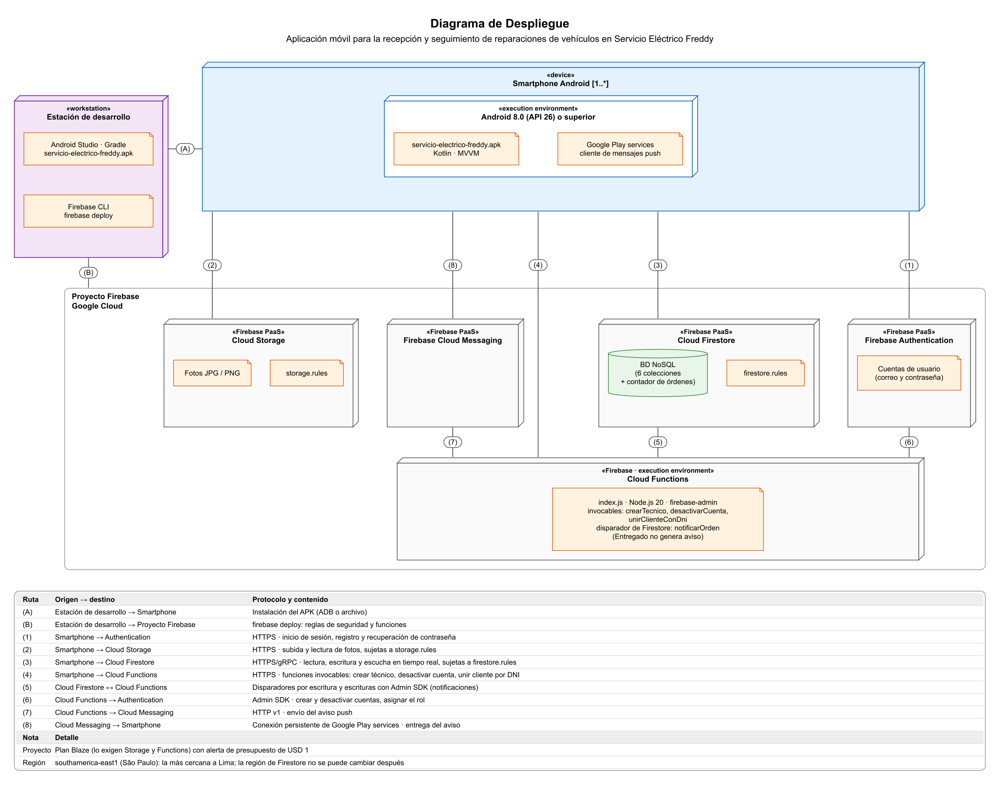

# PitLane · seguimiento de reparaciones

Aplicación Android para la recepción y el seguimiento de reparaciones de vehículos en **Servicio Eléctrico Freddy**. Reemplaza las fichas en papel: el cliente avisa la falla, el Jefe de Taller registra el ingreso con fotos, el técnico documenta los avances y el cliente sigue el estado hasta recibir su vehículo.

> **Estado:** la app funciona sobre **Firebase** (Authentication, Firestore, Storage y Cloud Functions, proyecto `pitlane-ad951`). Las reglas de seguridad, las funciones y cómo desplegarlas están en [`firebase/README.md`](firebase/README.md).

## Contenido

1. [Qué hace la app](#qué-hace-la-app)
2. [Procesos de negocio](#procesos-de-negocio)
3. [Arquitectura](#arquitectura)
4. [Requisitos funcionales](#requisitos-funcionales)
5. [Cómo ejecutarla](#cómo-ejecutarla)
6. [Pruebas](#pruebas)
7. [Estructura del repositorio](#estructura-del-repositorio)

## Qué hace la app

| Rol | Puede |
|---|---|
| **Jefe de Taller** | Ver el panel de órdenes (Ingresado, En reparación, Listo para recoger), atender solicitudes, buscar y registrar clientes, gestionar técnicos, registrar el ingreso con fotos, reenviar el aviso de vehículo listo y **entregar el vehículo** con conformidad del cliente. |
| **Cliente** | Registrarse, administrar su perfil y sus vehículos, enviar solicitudes de atención con fotos, seguir el estado de su orden (línea de tiempo, hallazgos, comprobante de ingreso y constancia de entrega) y recibir avisos. |
| **Técnico** | Ver las órdenes que tiene asignadas, iniciar la reparación, registrar hallazgos y trabajos realizados con fotos y marcar el vehículo como listo. |

Reglas de negocio que se hacen cumplir en los repositorios, entre otras:

- **RN-06:** solo el Jefe crea, edita, anula y entrega órdenes.
- **RN-07 / RN-08:** cada rol ve solo lo suyo (el Jefe todas las órdenes, el técnico las asignadas, el cliente las propias).
- **RN-13:** cada cambio de estado de una orden queda con fecha, hora y usuario.
- **RN-14:** una orden solo se entrega si tiene registrada la conformidad del cliente.

## Procesos de negocio

Los requisitos salen de las actividades en verde de tres procesos modelados en BPMN.

### Proceso 1 · Recepción del vehículo



### Proceso 2 · Reparación del vehículo



### Proceso 3 · Entrega del vehículo



## Arquitectura

La app sigue **MVVM + Repository**. Todo el patrón vive en una sola carpeta, `arquitectura/`, separado de `modelo/` y `util/`. Cada capa solo conoce a la de abajo.



| Capa | Carpeta | Contenido |
|---|---|---|
| Vista | `arquitectura/vista/` | Fragments y Activities con layouts XML y ViewBinding, por módulo |
| ViewModel | `arquitectura/viewmodel/` | Estado de pantalla con `StateFlow` |
| Repository | `arquitectura/repositorio/` e `impl/` | Interfaces `I*Repository` y sus implementaciones con las reglas de negocio |
| Fuentes de datos | `arquitectura/datasource/` y `firebase/` | Interfaces de acceso a datos y su implementación sobre Firebase |
| Fuera del patrón | `modelo/`, `util/` | Entidades y utilidades compartidas |

`Dependencias.kt` es la raíz de composición: el único lugar donde se decide qué implementación usa cada repositorio.

### Dependencias de cada repositorio



### Despliegue objetivo (Firebase)



## Requisitos funcionales

**61 historias de usuario** (143 puntos), derivadas de los tres procesos:

| Prioridad | Historias | Puntos |
|---|---|---|
| Must | 34 | 90 |
| Should | 23 | 46 |
| Could | 4 | 7 |
| **Total** | **61** | **143** |

Por rol: Jefe de Taller 27 · Cliente 22 · Técnico 9 · Todos 3.

## Cómo ejecutarla

**Requisitos:** Android Studio reciente, JDK 17 o superior (el proyecto se compila aquí con JDK 25) y un emulador o teléfono con Android 8.0 (API 26) o superior.

Necesitas `app/google-services.json`, que se descarga de la consola de Firebase y no se versiona.

```bash
./gradlew :app:assembleDebug     # compila
./gradlew :app:installDebug      # instala en el emulador o dispositivo conectado
```

En Android Studio, compilar no instala: usa **Run** para que el emulador reciba la versión nueva.

Las cuentas son reales. El primer Jefe de Taller se crea una sola vez con el script de siembra (ver `firebase/README.md`); desde su cuenta se registran los técnicos y los clientes, y los clientes también pueden crear su cuenta desde la app.

## Pruebas

```bash
./gradlew :app:testDebugUnitTest
```

Hay 113 pruebas unitarias: las reglas de negocio de los repositorios (`ReglasDeNegocioTest`, que usa una base de datos en memoria en lugar de Firebase), los mapeadores y el alcance por rol de Firebase, los validadores de formularios y las utilidades de texto. Las reglas de seguridad y las funciones del servidor tienen sus propias pruebas en el emulador (`firebase/`).

## Estructura del repositorio

```
app/src/main/java/com/leosle/pitlane/
├─ arquitectura/
│  ├─ vista/            pantallas por módulo
│  ├─ viewmodel/        un ViewModel por módulo
│  ├─ repositorio/      interfaces I*Repository
│  │  └─ impl/          implementaciones con las reglas de negocio
│  └─ datasource/       interfaces de acceso a datos
│     └─ firebase/      implementación sobre Firebase
├─ modelo/              entidades, enumeraciones y proyecciones
├─ util/                Resultado, Validador, Fechas, Textos, Reloj
├─ Dependencias.kt      raíz de composición
└─ AplicacionPitLane.kt
firebase/               reglas de seguridad, Cloud Functions y sus pruebas
diagramas/              imágenes de los procesos y de la arquitectura
odd/tasks/              bitácoras de las funcionalidades desarrolladas
scripts/                generadores de diagramas y scripts de entrega
```

La documentación completa (historias de usuario, guía de diseño, guías de exposición y fuentes de los diagramas) se mantiene en la carpeta local `docs/`, que no se versiona. El diagrama de componentes se regenera con `python3 scripts/diagrama-componentes/arquitectura_carpeta.py <salida.png>` (requiere Graphviz y `rsvg-convert`).
